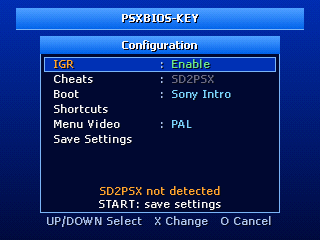
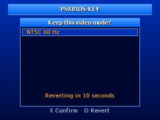
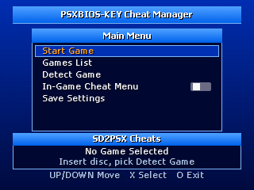
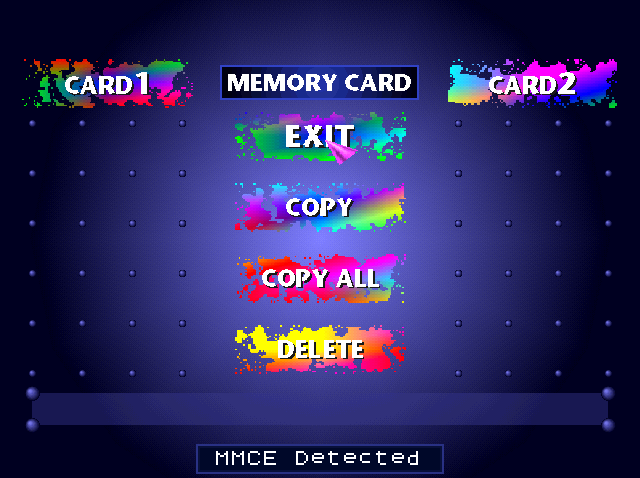
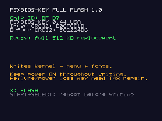

# PSXBIOS-KEY

## What it does

PSXBIOS-KEY patches the original Sony 4.1 BIOS disc authentication and boot sequence to unlock CD-R boot, and adds disc-based Game ID, cheats, in-game reset, UniROM, and an MMCE SD app launcher.

[Download the Windows patcher, cheats database, and app launcher](https://github.com/Hidden0-prj/PSXBIOS-KEY/releases/tag/v0.44)

## 0.51 test build

0.51 adds **Menu Video** to BIOS Config. PAL starts at 50 Hz and USA starts at 60 Hz. Hold **Select** at boot, choose **Menu Video**, then press **X** to preview. Press **X** to confirm, **O** to revert, or wait 10 seconds. Press **Start** to save. Use the included **Apps/BOOT.EXE 1.5** for the SD app menu.

0.51 is available for console testing. See the release notes for the IGR test result. [Download 0.51](https://github.com/Hidden0-prj/PSXBIOS-KEY/releases/tag/v0.51)

<table>
<tr>
<td width="50%" align="center"><strong>PAL Config</strong> </td>
<td width="50%" align="center"><strong>Video confirmation</strong> </td>
</tr>
</table>

## Features and controls

Hold a shortcut while turning on the console.

- **Select · BIOS Config.** Change the default boot option, choose the cheats source, or turn in-game reset on or off. Use **Save Settings** to keep your changes. Saving requires the flash **WE# connection** described below.
- **Start · Cheats Manager.** Use **Detect Game** to open cheats for the inserted disc, or **Game List** to browse. The in-game cheats menu is off by default and can be enabled in Config.
- **L1 · UniROM.** Opens UniROM 8.0.K.
- **R1 · Fast Boot.** Starts the disc through the faster boot path.
- **R2 · Quick Launch Apps.** Opens the app list on a compatible MMCE SD card. Press **Triangle** to refresh the list.
- **In-game reset.** With IGR enabled, press **L2 + R2 + Select + X** to reboot the console. This BIOS IGR hook supports games launched through its own boot path. Games launched through UniROM do not use it.

### MMCE features

**Apps, SD cheats, and MMCE controls require the latest compatible [sd2psXtd firmware](https://github.com/sd2psXtd/firmware/releases).** It adds the memory-card commands and SD file access used by these features. Choose firmware that supports your device and PS1 MFS1.

- **Game ID** selects a virtual save card for the disc you boot on compatible devices.
- **L2 / R2** switch virtual cards in the Sony Memory Card Manager.
- **L1 / R1** switch channels in the Sony Memory Card Manager.
- **MMCE Detected** appears when a compatible card is found.
- **SD cheats** loads the games database from the SD card.
- **R2 Apps** launches PS1 executables from the SD card's Apps folder.

### Screenshots

<table>
<tr>
<td width="50%" align="center"><strong>BIOS Config</strong> </td>
<td width="50%" align="center"><strong>Cheats Manager</strong> </td>
</tr>
<tr>
<td width="50%" align="center"><strong>SD2PSX Games List</strong> </td>
<td width="50%" align="center"><strong>Select Cheats</strong> </td>
</tr>
<tr>
<td width="50%" align="center"><strong>R2 Quick Launch Apps</strong> </td>
<td width="50%" align="center"><strong>Fast Boot</strong> </td>
</tr>
<tr>
<td width="50%" align="center"><strong>PlayStation BIOS Browser</strong> </td>
<td width="50%" align="center"><strong>MMCE Detected</strong> </td>
</tr>
<tr>
<td width="50%" align="center"><strong>UniROM</strong> </td>
<td width="50%" align="center"><strong>PS1 Full Flasher</strong> </td>
</tr>
</table>

**Windows Patcher**

## Setup

### Flash adapter

This release targets a **512 KiB SST39VF040**. Electroanalog's PSX Flash BIOS project has 32-pin and 40-pin adapter designs, installation photos, and programmer examples. Match the adapter to your motherboard. For in-console flashing, the installed adapter must be wired for console-controlled writes. The upstream build that ties write enable high is read-only in the console. [Electroanalog's PSX-Flash-BIOS guide](https://github.com/Electroanalog/PSX-Flash-BIOS)

Config saving and in-console flashing require a writable **WE#** connection. On the tested **SCPH-7501 / PU-22**, connect flash WE# to **CPU pin 100, /WR0**. Remove any direct WE-to-VCC bridge first. A **10 kΩ pull-up to 3.3 V** can remain. Verify the CPU pinout for your motherboard. [CPU pinout](https://psx-spx.consoledev.net/pinouts/#pinouts-cpu-pinouts)

### Patch your BIOS in Windows

Use your own original Sony 4.1 BIOS for one of these models.

- **USA / NTSC-U/C** · SCPH-7001 / SCPH-7501 family · CRC32 **502224B6**  
  `Sony PlayStation SCPH-7001 BIOS v4.1 (1997-12-16)(Sony)(US).bin`
- **Europe / PAL** · SCPH-7502 family · CRC32 **318178BF**  
  `Sony PlayStation SCPH-7502 BIOS v4.1 (1997-12-16)(Sony)(EU).bin`

Open **PSXBIOS-KEY-Patcher.exe**, choose your BIOS file and an output folder, then click **Apply Patch**.

It creates your patched BIOS, a PS1 flasher, and a flasher disc image.

### Install on a PlayStation

- **Fresh installation.** Program the generated BIOS BIN onto the SST39VF040 with your external programmer, verify it, then install the chip and adapter.
- **Adapter already installed.** With a working console and writable WE# wiring, load the generated self-contained PS1 flasher through UniROM/NOPS, or burn the generated CUE and boot the flasher disc. Keep its matching BIN beside the CUE when burning.
- **Flash.** Press **X**, wait for completion, then press **Start + Select** to reboot.

### Set up the MMCE : Memcardpro/sd2psx SD card

For now, the SD features require the latest compatible **sd2psXtd firmware with PS1 MFS1 filesystem support**. Check your device against the [firmware releases and installation guide](https://github.com/sd2psXtd/firmware/releases).

1. Download and extract **PSXBIOS-KEY-0.44.zip** from the [release page](https://github.com/Hidden0-prj/PSXBIOS-KEY/releases/tag/v0.44).
2. Copy **Apps** and **Cheats** from **MMCE SD Setup / Copy to SD card of MMCE** to your SD card root. Keep **Apps/BOOT.EXE**. Place your `.cht` files in **Cheats**, or copy the contents of **Cheats / US / Cheats**, **EU / Cheats**, or **JP / Cheats** from the download into it. Choose one database region.
3. Hold **Select** at boot, set **Cheats** to **SD2PSX**, and save. Hold **Start** at boot for **Detect Game** or **Game List**. Select the codes you want before starting the game.
4. Put your PS1 `.exe` apps in **Apps** and hold **R2** at boot. Press **Triangle** to refresh after adding files. RAM Tester, no$cash, and 240p are examples of apps you can add yourself.

Cheat selections last for the current boot. JP contains Japanese cheats. The patcher supports the listed USA and PAL BIOS dumps.

## Credits

- **xyz** for [SD2PSX](https://github.com/sd2psx/firmware), the [sd2psXtd Team](https://github.com/sd2psXtd), and [bbsan2k](https://github.com/bbsan2k).
- **jdfr228** for [PS1 Disc-Based Game ID](https://github.com/jdfr228/PS1-Disc-Based-Game-ID).
- **spicyjpeg** and contributors for [ps1-bare-metal](https://github.com/spicyjpeg/ps1-bare-metal).
- **Sickle**, **JonathanDotCel**, and the contributors to [UniROM](https://github.com/JonathanDotCel/unirom8_bootdisc_and_firmware_for_ps1).
- **Electroanalog** for the [PSX Flash BIOS adapters and photos](https://github.com/Electroanalog/PSX-Flash-BIOS).

## Terms of use

PSXBIOS-KEY is provided as-is, without warranty. Use it at your own responsibility. You are responsible for your hardware, BIOS backups, and any flashing or installation. Third-party components remain under their respective licenses.

