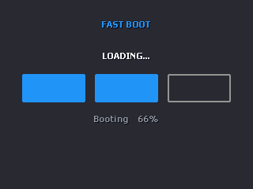
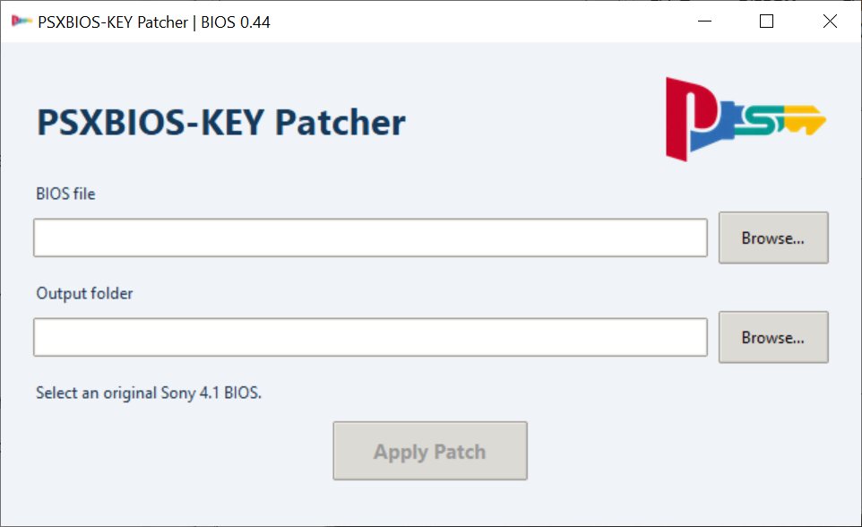

# PSXBIOS-KEY

## What it does

PSXBIOS-KEY is a custom BIOS for the original PlayStation. It keeps the Sony startup animation, sound, and menus, and adds CD-R boot, disc-based Game ID, UniROM, cheats, in-game reset, and an SD card app launcher.

[Download the Windows patcher, cheats database, and app launcher](https://github.com/Hidden0-prj/PSXBIOS-KEY/releases/tag/v0.44)

## Features and controls

Hold a shortcut while turning on the console.

- **Select · BIOS Config.** Change the default boot option, choose the cheats source, or turn in-game reset on or off. Use **Save Settings** to keep your changes on the flash chip.
- **Start · Cheats Manager.** Use **Detect Game** to open cheats for the inserted disc, or **Game List** to browse. The in-game cheats menu is off by default and can be enabled in Config.
- **L1 · UniROM.** Opens UniROM 8.0.K.
- **R1 · Fast Boot.** Starts the disc through the faster boot path.
- **R2 · Quick Launch Apps.** Opens the app list on a compatible MMCE SD card. Press **Triangle** to refresh the list.
- **In-game reset.** With IGR enabled, press **L2 + R2 + Select + X** to reboot the console.

Disc-based Game ID lets compatible memory cards select a save card for the game you boot. In the Sony Memory Card Manager, **L2/R2** switch MMCE cards and **L1/R1** switch channels.

### Screenshots

  
  

  
  

  

*Captured in PCSX-Redux with BIOS 0.44. The Memory Card Manager screenshot uses a simulated MMCE connection.*

## Setup

### Flash adapter

This release targets a **512 KiB SST39VF040**. Electroanalog's PSX Flash BIOS project has 32-pin and 40-pin adapter designs, installation photos, and programmer examples. Match the adapter to your motherboard. For in-console flashing, the installed adapter must be wired for console-controlled writes. The upstream build that ties write enable high is read-only in the console. [Electroanalog's PSX-Flash-BIOS guide](https://github.com/Electroanalog/PSX-Flash-BIOS)

### Patch your BIOS in Windows

Use your own original Sony 4.1 BIOS dump. Each supported file is **524,288 bytes**. The filenames below are for identification. The patcher checks the actual file and rejects other dumps.

- **USA / NTSC-U/C** · SCPH-7001 / SCPH-7501 family · CRC32 **502224B6**  
  `Sony PlayStation SCPH-7001 BIOS v4.1 (1997-12-16)(Sony)(US).bin`
- **Europe / PAL** · SCPH-7502 family · CRC32 **318178BF**  
  `Sony PlayStation SCPH-7502 BIOS v4.1 (1997-12-16)(Sony)(EU).bin`

Open **PSXBIOS-KEY-Patcher.exe**, choose your BIOS file and an output folder, then click **Apply Patch**.

The patcher creates a **BIOS BIN** for a chip programmer, a **self-contained PS1 flasher** (`.psexe`) with the BIOS already inside, and a **BIN/CUE flasher disc** with 50 MiB of padding.

### Install on a PlayStation

1. **Starting with a blank chip?** Use the generated BIOS BIN with an external programmer such as a T48 and the appropriate TSOP32 adapter. Verify the readback before installing the chip.
2. **Already have a working console with writable flash?** Launch the generated `.psexe` from UniROM/NOPS. If you already have Quick Launch Apps, give the flasher an `.exe` extension and put it in `Apps/`. If your console can already boot CD-Rs, you can also burn the flasher disc. Open the CUE in your disc-burning software and keep its matching BIN beside it.
3. **On the PS1,** check that the flasher shows your region and chip ID **BF D7**. The 0.44 image CRC32 is **E06FCC1B** for USA or **D37B13E5** for PAL. Press **X** to write. Wait for **SUCCESS – all 524288 bytes verified**, then press **Start + Select** to reboot.

*PS1 flasher shown in PCSX-Redux with a simulated flash chip.*

Full Flash writes the entire chip and resets BIOS settings. Keep power on until verification finishes. If the console can no longer boot after a failed write, use an external programmer to restore your backup. Version 0.44 is a test release. Physical console verification is pending.

### Set up the MMCE SD card

Download the ZIPs you need from the [release page](https://github.com/Hidden0-prj/PSXBIOS-KEY/releases/tag/v0.44). Extract them to the root of the SD card, alongside any folders already on it. Use MMCE firmware with **PS1 MFS1** filesystem support.

- **Cheats.** Extract **PSXBIOS-KEY-Cheats-ALL.zip** so that `Cheats/PSXKEYINDEX.cht` and the other files in the ZIP land in `Cheats/`. Hold **Select** at boot, set **Cheats** to **SD2PSX**, and save. Hold **Start** at boot to open the manager, then choose **Detect Game** or **Game List**. A standard memory card can also be used for its own cheats through the **Memory Card** setting.
- **Apps.** Extract **SD-Apps-Launcher-1.4.zip** so that `Apps/BOOT.EXE` is on the card. Copy your own PS1 `.exe` files into `Apps/` and hold **R2** at boot.

## Credits

- **jdfr228** for [PS1 Disc-Based Game ID](https://github.com/jdfr228/PS1-Disc-Based-Game-ID).
- **spicyjpeg** and contributors for [ps1-bare-metal](https://github.com/spicyjpeg/ps1-bare-metal).
- **Sickle**, **JonathanDotCel**, and the contributors to [UniROM](https://github.com/JonathanDotCel/unirom8_bootdisc_and_firmware_for_ps1).
- **Electroanalog** for the [PSX Flash BIOS adapters and photos](https://github.com/Electroanalog/PSX-Flash-BIOS).
- The [PS1 MMCE contributors](https://github.com/sd2psXtd/firmware) and the authors of [MKPSXISO](https://github.com/Lameguy64/mkpsxiso), [xdelta](https://github.com/jmacd/xdelta), and [7-Zip](https://www.7-zip.org/).
